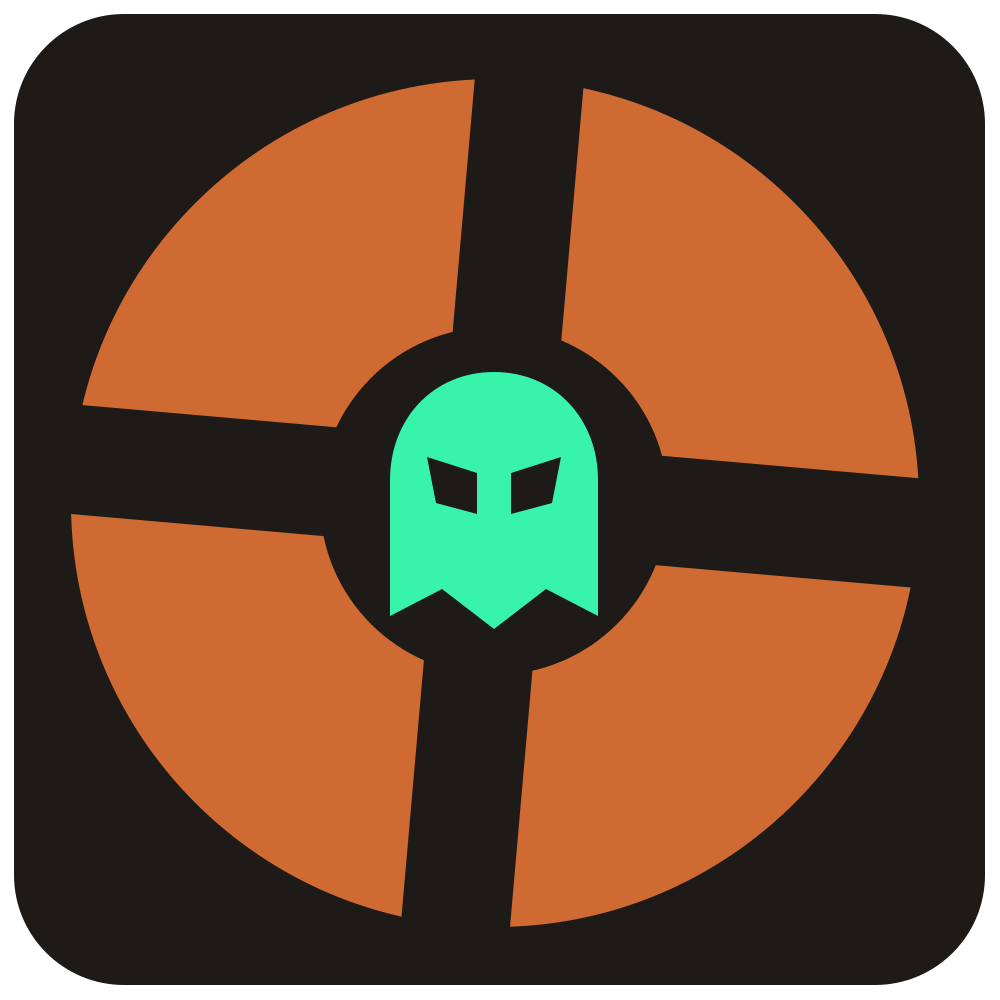
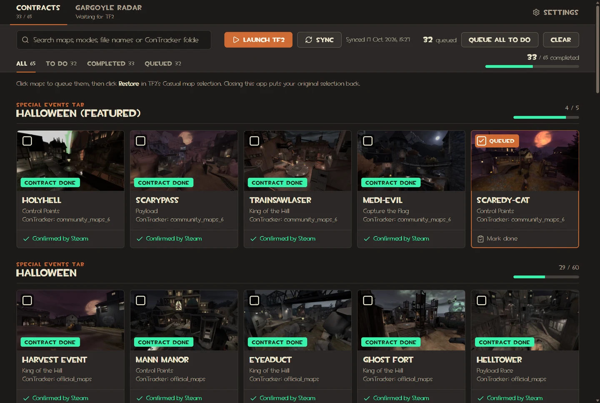

#  TF2 Halloween Utils

A Windows app with two tools for Team Fortress 2's Halloween event. **Contracts** is a checklist for the Halloween map contracts: it shows every Halloween map from the casual menu, pulls which contracts you have already completed from your Steam account, follows the match you are in, and writes the maps you still need straight into TF2's casual queue. **Gargoyle radar** draws an overlay over the game that points to your soul gargoyle. Each tool has its own tab, next to a **Settings** tab.

## What it does

Contracts:

- Lists all 65 Halloween maps grouped the way the casual menu groups them, with the ConTracker folder each contract sits in.
- Signs in to Steam once with a QR code from the Steam mobile app and syncs your completed contracts from the TF2 Game Coordinator. No password is typed anywhere.
- Shows the map you are playing right now, with its ConTracker folder, so you can find the contract in game. Asks whether you finished the contract when the match ends.
- Queues maps for you: click a tile here, click **Restore** in TF2's casual map selection, and TF2 loads that queue. Your original selection is put back when you quit the app, unless you turn that off in Settings.
- Syncs again by itself when TF2 closes, and lets you mark a contract done by hand in the meantime.

Gargoyle radar:

- Shows the direction and distance to your soul gargoyle, and whether it is above or below you, in a panel drawn over TF2.
- Reads your position and the gargoyle's position without changing any game files or reading the game's memory. See [the radar doc](.docs/radar.md).

## Requirements

- Windows (64-bit), with Team Fortress 2 installed through Steam. The app finds TF2 through Steam's library list.
- Microsoft Edge WebView2. It is built into Windows 11 and comes with Edge updates on Windows 10; if the app does not open, install the [WebView2 Runtime](https://developer.microsoft.com/microsoft-edge/webview2/).
- The Steam mobile app, for the one-time sign-in.
- Linux: version 2.0.0 is Windows only. Linux users can keep using 1.2.1 (the Node version, still on the [releases page](https://github.com/Rhgx/tf2-halloween-utils/releases)) until a Linux build is tested.

## Quick start

Download `tf2-halloween-utils.exe` from the [latest release](https://github.com/Rhgx/tf2-halloween-utils/releases/latest) and run it. There is nothing to install.

The app is not code-signed, so the first run shows a SmartScreen warning. Click **More info**, then **Run anyway**.

Your settings and Steam token are kept in `%APPDATA%\tf2-halloween-utils`. On first start the app copies the sign-in, synced contracts, manual marks and queue backup from the old `%APPDATA%\tf2-halloween-contracts` folder, once. The old folder is left as it is.

The app runs in the tray. Closing the window keeps the app running there by default, and frees the window's memory until you open it again. The tray menu has **Show** and **Quit**. Starting the app again shows the open window instead of starting a second copy.

## Using it

1. Click **Sign in with Steam** and scan the QR code in the Steam mobile app. The app syncs your completed contracts right away.
2. Click the maps you still want to play, or **Queue all to do**. Then open the casual map selection in TF2 and click **Restore**.
3. Play. The current map and its ConTracker folder show at the top of the page. When TF2 closes, the app syncs again so the checklist stays current.

To let the app follow your matches, add `-condebug` to TF2's launch options in Steam (right-click the game, Properties, Launch Options). Without it, everything else still works.

Syncing is blocked while TF2 is running, because Steam only allows one game session per account. The app never takes that session over.

For the gargoyle radar, open the **Gargoyle radar** tab and follow the setup steps there. They need a launch options line in Steam and a restart of TF2.

## Settings

- **Close to tray**: closing the window keeps the app running in the tray. With it off, closing the window quits the app.
- **Start minimized to tray**: the window stays hidden when the app starts.
- **Start with Windows**: starts the app at login, in the tray.
- **TF2 folder**: the folder found through Steam's libraries. **Change** picks another folder that has a `tf` folder inside, and **Use detected** goes back to the one that was found.
- **Restore original casual map selection on quit**: on by default. With it off, the app's queue stays in TF2 after the app closes.
- **Radar hotkeys**: the two in-game keys for the radar.
- **Data folder**: **Open folder** opens the folder where the app keeps its files.
- **Sign out** (in the Steam section): deletes the saved sign-in token.

## More

- [How the Steam sign-in and sync work, and what is stored](.docs/steam-sync.md)
- [How the app follows TF2 and writes the casual queue](.docs/tf2-integration.md)
- [The gargoyle radar: setup, settings, and how it works](.docs/radar.md)
- [Development: commands, layout, and building](.docs/development.md)
- [Credits for the fonts, screenshots, and libraries](.docs/credits.md)

## License

The code is under the [MIT License](LICENSE). Map screenshots and fonts are Valve's; see [credits](.docs/credits.md).
